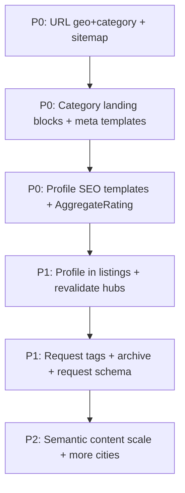

# SEO Technical Backlog — Shukayu

Джерело вимог: `docs/seo.txt` (консультація Gemini щодо SEO у Google).  
Мета документа: технічний чеклист того, **що доробити / змінити / допрацювати** на платформі, щоб Google бачив структурований каталог (товари + послуги), а не лише сирі UGC-запити.

### Зафіксовані продуктові рішення (2026-09-09)

| # | Рішення |
|---|---|
| Модель | **Переважно товари**; окремі (і майбутні) категорії — **послуги**. SEO-система має бути гібридною: тип сторінки/schema залежить від типу категорії. |
| URL профілю | Залишаємо **`/profile/{id}`** (без `/team/{slug}`). |
| Гео / ніші | Міста — з **локації** сутностей; ніші — з **дерева категорій**. Не фіксуємо «пілотну нішу» в продукті — масштабуємо шаблонами. |
| Порожні хаби | Публікуємо **одразу з шаблонним текстом** (не чекаємо N виконавців). |
| Meta / контент | **Автошаблони** + можливість **ручного редагування** (override у адмінці/CMS). |

Статус колонок:
- **Є** — уже частково або повністю в коді
- **Немає** — треба проєктувати й будувати
- **Допрацювати** — є база, але недостатньо для SEO-ефекту

---

## 0. Поточний стан (коротко)

| Область | Статус | Де в коді |
|---|---|---|
| `robots.txt` + sitemap + AI-боти | Є | `src/app/robots.ts`, `src/app/sitemap.ts` |
| Title/Description + canonical + hreflang | Є | `src/locales/route-metadata.ts`, `src/locales/{uk,en}/metadata.ts` |
| JSON-LD helpers (Organization, WebSite, BreadcrumbList, BlogPosting, FAQPage) | Є | `src/shared/seo/schemas.ts`, `JsonLd.tsx` |
| Динамічні meta для запиту | Є (частково) | `src/app/[locale]/request/[id]/page.tsx` |
| Публічний профіль `/profile/[id]` | Є | `src/app/[locale]/profile/[id]/page.tsx` |
| SEO-шаблони профілів (ім’я + послуга + місто) | Немає | зараз статичний generic title |
| Geo + category landing (`/uk/kyiv/santehnik/...`) | Немає | маршрутів немає |
| Профілі / категорії / виконані запити в sitemap | Немає / частково | sitemap: static + active requests + blog |
| Schema Product / Service / JobPosting / AggregateRating | Немає | helpers ще не покривають |
| Теги / кластеризація запитів | Немає | — |
| Архів «Виконано» для індексації | Немає / допрацювати | sitemap бере лише `status: 'active'` |

Категорії (`ICategory` з `slug`, `parentId`, дерево) і міста вже є як дані — **немає публічних SEO-сторінок поверх них**.

---

## 1. Пріоритет P0 — SEO-каркас (без нього UGC не «полетить»)

### 1.1. Дерево посадкових сторінок: локаль → місто → категорія → підкатегорія

**Статус:** Немає

**Цільова URL-схема (ЧПУ):**

```
/{locale}/{category}/
/{locale}/{city}/{category}/
/{locale}/{city}/{category}/{subcategory}/
/{locale}/profile/{id}/
```

Приклад:
- `/uk/elektronika/` (товарна категорія)
- `/uk/kyiv/elektronika/`
- `/uk/kyiv/vantazhoperevezennya/kvartyrnyj-pereyizd/` (послуга)
- `/uk/profile/64f1a2b3c4d5e6f7a8b9c0d1/`

**Що зробити:**

| # | Задача | FE | BE | Примітки |
|---|---|---|---|---|
| 1.1.1 | Маршрути App Router під geo+category | ✓ | — | нові сегменти; `generateStaticParams` / ISR |
| 1.1.2 | Slug для міст (kyiv, odesa, …) | ✓ | ✓ | зараз міста є, публічних slug URL — ні |
| 1.1.3 | Використати `ICategory.slug` + path у URL | ✓ | ✓ | перевірити унікальність і стабільність slug |
| 1.1.4 | Breadcrumbs UI + `BreadcrumbList` JSON-LD на кожному рівні | ✓ | — | база вже є в `breadcrumbs.tsx` / schemas |
| 1.1.5 | Canonical + hreflang для всіх нових сторінок | ✓ | — | через `buildAlternates` |
| 1.1.6 | Redirect/canonical з «голих» URL без міста (якщо потрібно) | ✓ | — | політика індексації |

**Критерій готовності:** Googlebot може обійти ієрархію через внутрішні лінки + sitemap; у Search Console з’являються URL типу `/uk/kyiv/...`.

---

### 1.2. Контент посадкової категорії (не порожній лістинг)

**Статус:** Немає

На кожній сторінці `{city}/{category}` мають бути блоки:

| Блок | Опис | Schema |
|---|---|---|
| H1 | Динамічний: «{Послуга} у {Місті} — знайти …» | — |
| Лістинг виконавців | TOP-N майстрів: фото, ім’я, рейтинг, ціна «від», CTA | `ItemList` (опційно) |
| Таблиця цін | Агрегат min-цін з профілів / прайсів | таблиця в HTML |
| SEO-текст | 300–800 слів (шаблон + CMS/ручне редагування) | — |
| FAQ 3–5 Q&A | шаблон з підстановкою міста/ціни | `FAQPage` (helper уже є) |
| Внутрішня перелінковка | «Службові теги» / related subcategories | — |
| Живі метрики | к-сть майстрів, мін. ціна, оновлення дати | сигнал freshness |

**Що зробити:**

| # | Задача | FE | BE |
|---|---|---|---|
| 1.2.1 | API: список публічних виконавців за city+category (рейтинг, ціна від) | — | ✓ |
| 1.2.2 | API/CMS: SEO-поля категорії (title/description/H1/body/FAQ) з плейсхолдерами | ✓ | ✓ |
| 1.2.3 | Агрегація цін для таблиці | ✓ | ✓ |
| 1.2.4 | Рендер FAQ + `getFaqPageJsonLd` | ✓ | — |
| 1.2.5 | Блок related categories / tags | ✓ | ✓ |
| 1.2.6 | Порожній лістинг: шаблонний SEO-текст + CTA (не `noindex`) | ✓ | ✓ |
| 1.2.7 | Прапор `category.kind`: `goods` \| `services` → копірайт + schema | ✓ | ✓ |

**Критерій готовності:** сторінка категорії самодостатня для сніпета (title, description, FAQ rich result; лістинг або шаблонний empty-state).

---

### 1.3. Авто-шаблони мета-тегів + ручний override

**Статус:** Немає

Шаблони різняться за `category.kind` (товари vs послуги). Приклади:

**Товари — регіональний хаб**
- Title: `{Категорія} {Місто}: купити вигідно — запити та пропозиції | Shukayu`
- Description: `Шукаєте {категорія} у м. {Місто}? Створіть запит на Shukayu — продавці надішлють ціни. Активних запитів: {N}.`
- H1: `{Категорія} у {Місті} — знайти продавця`

**Послуги — регіональний хаб** (як у `seo.txt`)
- Title: `{Категорія} {Місто} недорого: замовити | Shukayu`
- Description: `Шукаєте {категорія} у м. {Місто}? Порівнюйте ціни та відгуки про {N} виконавців на Shukayu. Від {minPrice} грн.`
- H1: `{Категорія} у {Місті} — знайти виконавця`

| # | Задача | FE | BE |
|---|---|---|---|
| 1.3.1 | Система шаблонів meta з плейсхолдерами `{city}`, `{category}`, `{count}`, `{minPrice}` + окремі набори для goods/services | ✓ | ✓ |
| 1.3.2 | Адмінка: редагування title / description / H1 / body / FAQ поверх шаблону (override) | ✓ | ✓ |
| 1.3.3 | Унікальність title між містами/категоріями (перевірка дублів) | — | ✓ |
| 1.3.4 | Fallback: якщо override порожній → автошаблон | ✓ | ✓ |

---

## 2. Пріоритет P0 — Картки виконавців (E-E-A-T)

### 2.1. SEO-URL і індексація профілів

**Статус:** Допрацювати

**Рішення:** URL лишається `/{locale}/profile/{id}`. SEO-ефект дає не slug, а унікальні meta + контент + schema + присутність у sitemap.

| # | Задача | FE | BE |
|---|---|---|---|
| 2.1.1 | ~~Публічний slug~~ — **не робимо** (зафіксовано `/profile/{id}`) | — | — |
| 2.1.2 | Динамічний Title/Description з даних профілю (role: buyer/seller + категорії) | ✓ | — |
| 2.1.3 | Додати публічні профілі в `sitemap.ts` | ✓ | ✓ (API list) |
| 2.1.4 | `robots`: лишити noindex лише на приватний `/profile` (вже є) | ✓ | — |
| 2.1.5 | OG-зображення профілю (аватар / дефолт) | ✓ | — |

**Шаблон meta (залежить від ролі / kind категорій):**
- Продавець товарів: `{Ім'я} — продавець {Категорія} в {Місто} | Відгуки на Shukayu`
- Виконавець послуг: `{Ім'я} — {Послуга} в {Місто} | Відгуки та ціни на Shukayu`
- Description: профіль, рейтинг, категорії, місто; CTA «дивитися відгуки / пропонувати».

---

### 2.2. Контент картки (те, що любить Google)

**Статус:** Допрацювати (відгуки є; прайс/портфоліо/біо як SEO-блоки — уточнити наявність у моделі)

| Блок | Вимога | Schema |
|---|---|---|
| Біографія | мін. 300–500 символів, модерація на копіпаст | `Person` / `LocalBusiness` |
| Прайс-лист | HTML-таблиця «послуга → від … грн» | `Offer` / `PriceSpecification` |
| Відгуки | вже є UI — додати розмітку | `AggregateRating` + `Review` |
| Портфоліо | галерея + **alt** з послугою/містом/ім’ям | ImageObject (опційно) |
| Спеціалізації + місто | чіткі поля, не лише в тексті | — |

| # | Задача | FE | BE |
|---|---|---|---|
| 2.2.1 | Мінімальна довжина / обов’язковість «Про себе» для публічної індексації | ✓ | ✓ |
| 2.2.2 | Структурований прайс (не вільний текст) | ✓ | ✓ |
| 2.2.3 | `AggregateRating` + `Review` JSON-LD | ✓ | ✓ (stats API вже є) |
| 2.2.4 | Авто-alt для фото портфоліо | ✓ | ✓ (метадані файлу) |
| 2.2.5 | Політика: thin-профілі → `noindex` до заповнення | ✓ | ✓ |

---

### 2.3. Синергія профіль ↔ категорія

**Статус:** Немає

При реєстрації / виборі категорії + міста:

1. Картка з’являється в лістингу `/uk/{city}/{category}/`
2. На хабі оновлюються count і min price
3. Профіль отримує унікальний URL і meta

| # | Задача | FE | BE |
|---|---|---|---|
| 2.3.1 | Індекс/фільтр виконавців city×category | — | ✓ |
| 2.3.2 | Інвалідація / revalidate хабів при зміні профілю | ✓ | ✓ |
| 2.3.3 | Внутрішні лінки: профіль → категорії; категорія → профілі | ✓ | — |

---

## 3. Пріоритет P1 — Запити як long-tail контент

Самі запити — паливо, не каркас. Їх треба **структурувати**, а не очікувати ранжування «як є».

### 3.1. Теги та кластеризація

**Статус:** Немає

| # | Задача | FE | BE |
|---|---|---|---|
| 3.1.1 | Авто-прив’язка запиту до category (+ suggested tags) | ✓ | ✓ |
| 3.1.2 | Теги: послуга, місто, тип робіт (`#сантехнік`, `#Київ`, …) | ✓ | ✓ |
| 3.1.3 | Хаби за тегами або редірект тегів на category/city URL | ✓ | ✓ |
| 3.1.4 | Модерація / AI-assist для нормалізації тексту запиту | ✓ | ✓ |

---

### 3.2. Архівування замість видалення

**Статус:** Допрацювати

| # | Задача | FE | BE |
|---|---|---|---|
| 3.2.1 | Статус «Виконано» / «Архів» лишається публічним (кейс) | ✓ | ✓ |
| 3.2.2 | Sitemap: completed + active (з коректним `lastmod`) | ✓ | ✓ |
| 3.2.3 | Не видаляти з індексу після закриття (soft-delete ≠ hard-delete) | — | ✓ |
| 3.2.4 | Пагінація / sitemap index при зростанні обсягу (>50k URL) | ✓ | ✓ |

Зараз `getRequestEntries()` бере лише `status: 'active'` і `pageSize: 100` — для SEO цього мало.

---

### 3.3. Мікророзмітка сторінки запиту

**Статус:** Немає

| # | Задача | FE | BE |
|---|---|---|---|
| 3.3.1 | Schema за `category.kind`: товари → `Product` (або Offer); послуги → `Service` (JobPosting лише якщо доречно) | ✓ | — |
| 3.3.2 | JSON-LD на `request/[id]` + BreadcrumbList | ✓ | — |
| 3.3.3 | Зв’язок запиту з category/city у розмітці | ✓ | ✓ |

---

## 4. Пріоритет P1 — Технічний SEO (інфраструктура)

| # | Задача | Статус | Де |
|---|---|---|---|
| 4.1 | Розширити sitemap: categories, city×category, public profiles, completed requests | Допрацювати | `sitemap.ts` |
| 4.2 | Sitemap index / chunking | Немає | — |
| 4.3 | Core Web Vitals на нових лістингах (SSR/ISR, lazy images) | Допрацювати | App Router |
| 4.4 | `Person` / `LocalBusiness` / `AggregateRating` / `Service` helpers | Немає | `src/shared/seo/schemas.ts` |
| 4.5 | Валідація rich results (Search Console + Rich Results Test) | Процес | — |
| 4.6 | `noindex` лише для дублів (фільтри/сортування/пагінація query); **порожні хаби індексуємо** з шаблонним текстом | Немає | policy |
| 4.7 | Внутрішня перелінковка з головної / how-it-works / blog → SEO-хаби | Допрацювати | контент + UI |
| 4.8 | Локалі uk/en: повні шаблони й контент для обох мов | Допрацювати | i18n |

---

## 5. Пріоритет P2 — Контент і семантика (не лише код)

Без цього техніка дасть слабкий ефект:

| # | Задача | Відповідальний |
|---|---|---|
| 5.1 | Семантичне ядро по ТОП-категоріях (Київ + ще 5–10 міст) | SEO / маркетинг |
| 5.2 | Пріоритетний пілот: 1 ніша (напр. вантажоперевезення) end-to-end | Product + Eng |
| 5.3 | Ручні SEO-тексти для ТОП-50 хабів; решта — шаблони | Контент |
| 5.4 | FAQ-бібліотека по категоріях | Контент + FE шаблони |
| 5.5 | Правила модерації біо/портфоліо (анти-копіпаст) | Ops + BE |

---

## 6. Рекомендований порядок впровадження



**MVP SEO:** універсальний генератор хабів `city × category` з шаблонами goods/services + override + профілі `/profile/{id}` з динамічними meta + FAQ/schema. Обмеження rollout — технічні (які city/category slug уже є в даних), а не «обрана ніша».

---

## 7. Критерії успіху (вимірювані)

| Метрика | Через 4–8 тижнів після пілоту |
|---|---|
| Проіндексовані URL category/city | зростання в GSC |
| Імпресії / кліки по комерційних запитах «{категорія} {місто}» (товари і послуги) | зростання vs baseline |
| Rich results (FAQ, зірки рейтингу) | з’являються у видачі |
| Organic CTR профілів | +20%+ при зірках (орієнтир з `seo.txt`) |
| Частка трафіку не з brand-запитів | зростання |

---

## 8. Продуктові рішення — статус

| # | Питання | Рішення | Примітка |
|---|---|---|---|
| 1 | Товари vs послуги | Гібрид: default **товари**, окремі категорії — **послуги** (`kind`) | Schema і копірайт від `kind` |
| 2 | URL профілю | **`/profile/{id}`** | Slug не в scope |
| 3 | Міста / ніші | З **location** і **category tree** | Немає фіксованого «пілота ніші» |
| 4 | Порожні хаби | Публікувати з **шаблонним текстом** | Ризик thin content — див. §8.1 |
| 5 | Meta/контент | **Автошаблони + редагування** | Override > template |

### 8.1. Де відповіді варто тримати «з обережністю» (не помилки)

Це не «неправильні» відповіді — просто місця, де Google часто карає, якщо не закласти захист:

1. **Порожні хаби з шаблоном** — ок як продукт, але якщо сотні міст × категорій з майже ідентичним текстом, Google може згорнути як thin/doorway. Мітигація: унікальні плейсхолдери (N, minPrice, related links, локальні FAQ), не генерувати URL без реального міста/категорії в довідниках, моніторити GSC «Discovered – currently not indexed».
2. **`/profile/{id}`** — ок і простіше. Мінус: URL гірше «читається» в видачі. Компенсація: сильний title/H1 з ім’ям і категорією (це вже в backlog).
3. **«Міста по локації, ніші по категорії»** — правильна архітектура. Єдине уточнення для eng: сторінку `/{city}/{category}` створюємо лише коли є валідні slug у довідниках (не з довільного тексту в запиті). Інакше — сміттєві URL.
4. **Гібрид товари/послуги** — потрібен явний прапор на категорії (`goods` \| `services`), інакше шаблони й schema будуть плутатись.

Залишилось уточнити лише технічно (коли дійдемо до імплементації): де живе override (існуюча admin vs нова SEO-адмінка) і хто дефолт `kind` для поточних категорій.

---

## 9. Зв’язок із існуючими файлами

| Файл | Роль |
|---|---|
| `docs/seo.txt` | Вхідні рекомендації (Gemini) |
| `docs/SEO_TECHNICAL.md` | Цей backlog для eng/product |
| `docs/I18N.md` | Метадані uk/en |
| `src/shared/seo/*` | Розширювати schema helpers |
| `src/app/sitemap.ts` / `robots.ts` | Розширювати покриття |
| `src/entities/category/*` | Джерело дерева для хабів |
| `src/entities/location/*` | Джерело міст / slug |

---

*Документ можна оновлювати по мірі закриття пунктів (статус → Є / дата / PR).*
